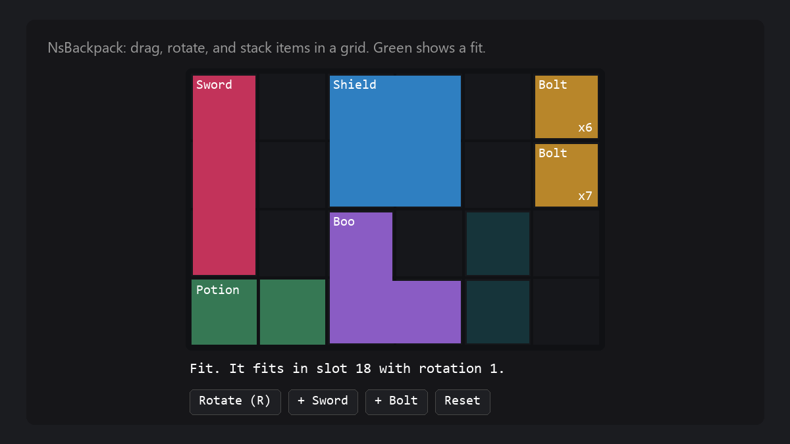

# NsBackpack User Guide

## Purpose

NsBackpack gives an actor an inventory of slots. Each slot holds an item, a quantity, and optional data for that one item. An item is a data asset with a name, an icon, a mesh, a stack size, and fragments that your game makes. The `NsBackpackGrid` module puts the slots in a grid, where an item covers the cells of its shape.

NsBackpack has no UI, no selected slot, no item use, no crafting, and no save system. It has no server RPCs. Your game builds these parts on top of the backpack.

[](Showcase/GridBackpack.html)

## Setup

1. Copy the `NsBackpack` folder into the `Plugins` folder of your project.
2. Open the project and enable NsBackpack in **Edit > Plugins**.
3. For C++, add `"NsBackpack"` to the dependencies of your game module in `Build.cs`.
4. For a grid in C++, also add `"NsBackpackGrid"`.
5. Restart the editor.

The plugin has no project settings.

## Quick Start

1. In the Content Browser, select **Add > Miscellaneous > Data Asset**.
2. Pick `NsBackpackItemDefinition` and name the asset `DA_Bolt`.
3. Open `DA_Bolt`. Set **Display Name** to Bolt and **Max Stack** to 10.
4. Open your character Blueprint and add the **Ns Backpack** component.
5. In the component, add an entry to **Start Items**. Set **Item** to `DA_Bolt` and **Quantity** to 15.
6. In the Event Graph, bind `On Changed` and print `Get Slots`.
7. Press Play. The backpack holds 10 bolts in slot 0 and 5 bolts in slot 1.

In C++:

```cpp
#include "NsBackpackComponent.h"

// In the constructor of the character
Backpack = CreateDefaultSubobject<UNsBackpackComponent>(TEXT("Backpack"));

// On the server. The return value is the quantity that did not fit.
const int32 Left = Backpack->AddItem(BoltItem, 15);
```

## Common Tasks

### Add items

1. On the server, call `Add Item` with the item and the quantity.
2. Read the return value. It is the quantity that did not fit.

The items fill the stacks of the same item first. Then they go into empty slots, one full stack at a time.

### Remove items

1. Call `Remove Item` with the item and the quantity to remove the items from the first slots first.
2. Call `Remove From Slot` with a slot index and a quantity to remove items from one slot.

Both calls return false and remove nothing when the backpack, or the slot, holds fewer items.

### Move items between slots

1. Call `Move Slot` with the source slot and the target slot.

The items join the target stack when it has room. The rest stays in the source slot. When the items cannot join, the two slots swap.

### Read the backpack

1. Call `Get Slots` for all slots, or `Get Slot` for one slot.
2. Call `Count Item` for the total of one item.
3. Call `Find Item` for the first slot with the item, or `Find Empty Slot` for the first empty slot. Both return -1 when nothing matches.

### Update the UI

1. Bind `On Changed` on the backpack.
2. In the event, read the slots again.

`On Changed` fires on the server and on each client after the slots change.

### Add game data to an item

1. Make a Blueprint or C++ child class of `NsBackpackItemFragment`.
2. Add the variables that your game needs.
3. Open the item asset and add an entry to **Fragments**.
4. Pick your fragment class and set its values.
5. In Blueprint, call `Find Fragment` with the class. In C++, call `Item->FindFragment<UMyFragment>()`.

### Keep state for one item

1. Make a struct for the state, for example the durability of one sword.
2. Put the struct in the **Data** field of the slot, with `Set Slot`.

A slot with data does not stack.

### Add a slot rule

1. Make a Blueprint or C++ child class of the backpack component.
2. Override `Can Accept` to allow or block an item in a slot, for example a slot for tools only.
3. Override `Can Stack` to allow or block a stack.

The default `Can Accept` returns true. The default `Can Stack` needs the same item and no slot data.

### Save and load a backpack

1. To save, read `Get Slots` and store each slot in your save game.
2. To load, call `Reset Slots` with the saved slot count.
3. Call `Set Slot` for each saved slot.

For a grid backpack, call `Reset Grid`, then `Set Grid Slot` with the saved rotation from `Get Rotation`.

### Use a grid

1. Add the **Ns Backpack Grid** component in place of **Ns Backpack**.
2. Set **Grid Width** to the number of columns.
3. Set **Slot Count** to the number of cells, a multiple of **Grid Width**.
4. On each item that covers more than one cell, add a **Grid Shape** fragment.
5. Set **Size** on the fragment, for example 2 x 2.
6. For an L or another shape, list the **Cells** inside the box.

A slot index is a cell index, row by row from the top left. An item sits in the slot of the top left cell of its box. An item without a **Grid Shape** fragment covers one cell. `Add Item` tries every cell with no rotation first, then with quarter turns.

### Move or turn an item in a grid

1. Call `Can Place` with the item, the target cell, and the rotation to show a preview.
2. Call `Move Item` with the source slot, the target cell, and the rotation.
3. Call `Rotate Item` to turn an item one quarter turn clockwise on its cell.

A rotation is a number of clockwise quarter turns, from 0 to 3. A grid move never swaps two items. A move onto a stack of the same item joins the stack.

### Find what covers a cell

1. Call `Get Cell Owner` with a cell index. It returns the slot of the item that covers the cell, or -1.
2. Call `Get Item Cells` with a slot index for all cells of that item.
3. Call `Get Cell Index` and `Get Cell Position` to convert between a cell index and a column and row.

In a grid, an empty slot can be under another item. Use `Get Cell Owner` or `Find Empty Slot` to find a free cell, not `Get Slot`.

## Settings

### Ns Backpack component

| Setting | Default | Effect |
|---|---|---|
| **Slot Count** | 8 | Number of slots when play starts. |
| **Start Items** | Empty | Items that the backpack gets when play starts. Each entry has an **Item** and a **Quantity** (default 1). |

### Ns Backpack Grid component

| Setting | Default | Effect |
|---|---|---|
| **Slot Count** | 16 | Number of cells when play starts. |
| **Grid Width** | 4 | Number of columns. |
| **Start Items** | Empty | Items that the backpack gets when play starts. |

### Item definition

| Setting | Default | Effect |
|---|---|---|
| **Display Name** | Empty | Name for the UI. |
| **Description** | Empty | Text about the item for the UI. |
| **Icon** | None | Texture for the UI. |
| **World Mesh** | None | Static mesh for the item in the world. |
| **Max Stack** | 1 | Most items in one slot. The minimum is 1. |
| **Fragments** | Empty | Game data of the item. |

The plugin does not read **Display Name**, **Description**, **Icon**, or **World Mesh**. Your UI and game code read them.

### Grid Shape fragment

| Setting | Default | Effect |
|---|---|---|
| **Size** | 1 x 1 | Width and height of the box of the shape, in cells. |
| **Cells** | Empty | Cells of the shape inside the box, from the top left. Empty fills the whole box. |

## Debug

The plugin has no console commands, console variables, or log category.

Data validation on an item definition reports these messages:

- Error: "A fragment entry is empty. Pick a fragment class or remove the entry."
- Warning: "Two fragments are of class {0}. Only the first one counts."

Run data validation on the item asset from the Content Browser to see them.

## Troubleshooting

| Problem | Cause | Fix |
|---|---|---|
| `Add Item` returns the full quantity, and nothing changes. | The call ran on a client. Only the server can change the slots. | Call it on the server, for example from a server RPC of your game. |
| `Add Item` returns more than 0. | No stack has room and no empty slot accepts the item. | Add slots with `Reset Slots`, or read the return value and drop the rest. |
| `Remove Item` returns false. | The backpack holds fewer items than the quantity. | Call `Count Item` first. |
| Two slots of the same item do not join. | A slot has **Data**, or `Can Stack` returns false. | Clear the slot data, or check your `Can Stack` override. |
| `Move Slot` returns false. | The source slot is empty, the indices are the same, or `Can Accept` blocks the swap. | Check the slots and your `Can Accept` override. |
| A grid item does not fit. | A cell of the shape is outside the grid or under another item. | Call `Find Placement` to get a free cell and rotation. |
| The last cells of a grid stay empty. | **Slot Count** is not a multiple of **Grid Width**. Only full rows count. | Set **Slot Count** to a multiple of **Grid Width**. |
| A change to **Slot Count** in play does nothing. | The backpack reads **Slot Count** only in `BeginPlay`. | Call `Reset Slots` or `Reset Grid`. |
| A second fragment of one class has no effect. | `Find Fragment` returns the first match. | Keep one fragment of each class. |

## Limits

- Only the server, or a backpack without an owner, can change the slots.
- The number of slots stays fixed until the next `Reset Slots` or `Reset Grid` call.
- `Set Slot` does not limit the quantity to **Max Stack**.
- A slot with data does not stack.
- A grid move never swaps two items.
- The grid builds its cell map again on each query, so large grids cost more.
